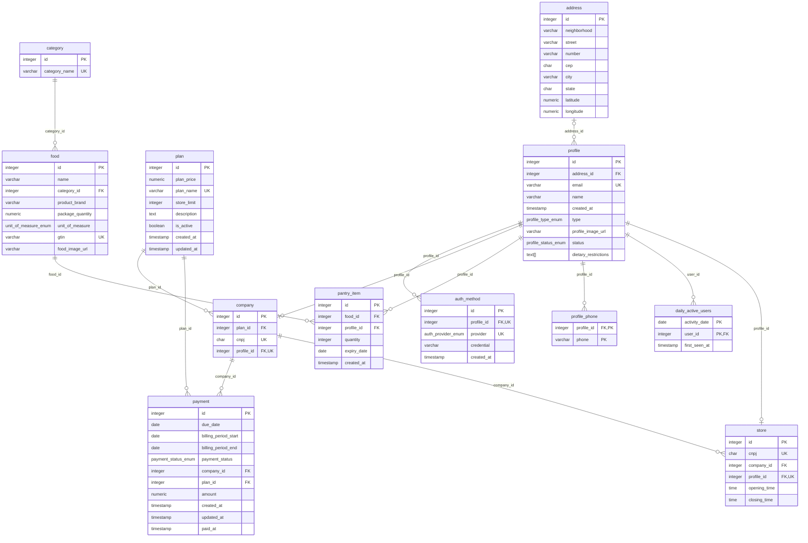

# Catálogo de metadados — NexUs

Descreve **o que cada dado significa, onde ele vive, como é definido e quão sensível ele é**,
nos três repositórios de dados do NexUs. Para ter o catálogo como tabela no banco (schema `catalogo`),
rode os scripts de [script/05_catalogo/](../../script/05_catalogo/) na ordem `01`, `02` e `03`.

| # | Seção | Conteúdo |
|---|---|---|
| 1 | [PostgreSQL — schema `public`](#1-postgresql-schema-public) | 11 tabelas transacionais, 5 enums, regras de negócio e diagrama ER |
| 2 | [Data mart — schemas `bi` e `bi_hist`](#2-data-mart-schemas-bi-e-bi_hist) | Dimensões, fatos e KPIs de desperdício (star schema) |
| 3 | [MongoDB](#3-mongodb) | 9 collections: receitas, eventos, notificações, IA e telemetria |

## Como ler este catálogo

Para cada tabela, view ou collection: descrição e, por coluna, **tipo**, **nulo**, **padrão**,
**chave** (PK, FK com destino, UK), **classificação LGPD** e **descrição**. Abaixo de cada tabela
ficam as regras (checks, FKs com ação de `ON DELETE`, índices e triggers).

Fonte: migrations `V1` a `V12`, `script/04_monitoramento/script_dau.sql`,
`script/03_bi_views/datamart_estrela.sql` e as factories do dataload (MongoDB). A conferência
catálogo × banco real está em [engenharia_de_dados.md](../engenharia_de_dados.md).

### Classificação LGPD

| Nível | Significado | Exemplos |
|---|---|---|
| `INTERNO` | Dado de negócio, sem dado pessoal | `food.gtin`, `payment.amount` |
| `PESSOAL` | Identifica ou localiza uma pessoa (art. 5º, I) | `profile.email`, `address.street`, `profile_phone.phone` |
| `SENSIVEL` | Dado pessoal sensível: saúde, religião (art. 5º, II) | `profile.dietary_restrictions` |
| `SIGILOSO` | Credencial; nunca sai da aplicação | `auth_method.credential` |

### Níveis de acesso

No banco: tabela `catalogo.nivel_acesso`, exposta em `catalogo.vw_dicionario_dados`
(colunas `nivel_acesso` e `quem_acessa`). Cada objeto também tem `regra_negocio`.

| Nível | Classificação | Quem acessa | Regra |
|---|---|---|---|
| 1 | `INTERNO` | Serviços do NexUs, equipe de dados e BI | Pode ir para o data mart e dashboards. |
| 2 | `PESSOAL` | Serviços do NexUs e suporte, para o próprio titular | Não vai para o BI; só sai do banco mascarado ou agregado. |
| 3 | `SENSIVEL` | Serviços do NexUs, para o próprio titular | Exige consentimento; nunca vai para BI, logs ou exportações. |
| 4 | `SIGILOSO` | Somente o serviço de autenticação (auth-api) | Nunca é lido por pessoas nem exibido; guardar só hash ou subject. |

### Glossário

| Termo | Significado |
|---|---|
| Household | Casa/usuário final do app; dono da despensa. Perfil do tipo `HOUSEHOLD`. |
| Company / Store | Empresa cliente (B2B) e suas lojas; cada uma também é um perfil. |
| Despensa | Itens que o household tem hoje (`pantry_item`), na despensa, geladeira ou freezer. |
| GTIN | Código de barras do produto (EAN-13 no Brasil, prefixo 789). |
| SK | *Surrogate key*: chave das dimensões no data mart. `-1` = não informado. |
| Grão | O que uma linha da tabela fato representa. |
| Dataload BI | Carga de ~12 meses simulados para o BI; perfis com e-mail `@bi.nexus.local`. |

---

## 1. PostgreSQL (schema `public`)

### Sumário

| Objeto | Tipo | Colunas | Descrição |
|---|---|---|---|
| [`address`](#address) | tabela | 9 | Endereços de households, empresas e lojas. Usado na análise regional (cidade, UF, região). |
| [`auth_method`](#auth_method) | tabela | 5 | Formas de login do perfil: no máximo uma por provedor. |
| [`daily_active_users`](#daily_active_users) | tabela | 3 | Monitoramento (DAU): 1 linha por usuário (profile) ativo por dia. Criada por `script/04_monitoramento/script_dau.sql`, fora do Flyway. |
| [`vw_dau`](#vw_dau) | view | 2 | Monitoramento: quantidade de usuários ativos (DAU) por dia. |
| [`category`](#category) | tabela | 2 | Domínio: categorias de alimentos (17 fixas, iguais às do supermercado). |
| [`company`](#company) | tabela | 4 | Empresa cliente (B2B). Cada empresa é também um perfil COMPANY. |
| [`food`](#food) | tabela | 8 | Catálogo de alimentos (SKU): produto + marca + embalagem, identificado pelo GTIN. |
| [`pantry_item`](#pantry_item) | tabela | 6 | Itens na despensa, geladeira ou freezer do household hoje. Um registro por lote comprado. |
| [`payment`](#payment) | tabela | 11 | Cobranças mensais do plano de cada empresa. |
| [`plan`](#plan) | tabela | 8 | Domínio: planos de assinatura das empresas (Ceris, Enterprise, Exclusive). |
| [`profile`](#profile) | tabela | 9 | Perfil de acesso ao NexUs. O tipo define o papel e não pode mudar depois de criado (trg_profile_type_lock). |
| [`profile_phone`](#profile_phone) | tabela | 2 | Telefones do perfil (0..N por perfil). |
| [`store`](#store) | tabela | 4 | Loja (filial) de uma empresa. Cada loja é também um perfil STORE. |

### Diagrama entidade-relacionamento

### Tabelas

#### `address`

*tabela* — Endereços de households, empresas e lojas. Usado na análise regional (cidade, UF, região).

| Coluna | Tipo | Nulo | Padrão | Chave | LGPD | Descrição |
|---|---|---|---|---|---|---|
| `id` | integer | não | nextval('address_id_seq'::regclass) | PK | INTERNO | Identificador do endereço (serial). |
| `neighborhood` | character varying(100) | não | — | — | PESSOAL | Bairro. |
| `street` | character varying(150) | não | — | — | PESSOAL | Logradouro. |
| `number` | character varying(10) | não | — | — | PESSOAL | Número do imóvel (texto: aceita S/N, 12A). |
| `cep` | character(8) | não | — | — | PESSOAL | CEP com 8 dígitos, sem máscara. |
| `city` | character varying(100) | não | — | — | INTERNO | Cidade. |
| `state` | character(2) | não | — | — | INTERNO | UF com 2 letras maiúsculas. Ex.: SP. |
| `latitude` | numeric(9,6) | sim | — | — | PESSOAL | Latitude em graus decimais (V4). |
| `longitude` | numeric(9,6) | sim | — | — | PESSOAL | Longitude em graus decimais (V4). |

Regras:

- **check** `address_cep_check`: `CHECK ((cep ~ '^\d{8}$'::text))`
- **check** `address_state_check`: `CHECK ((state ~ '^[A-Z]{2}$'::text))`

#### `auth_method`

*tabela* — Formas de login do perfil: no máximo uma por provedor.

| Coluna | Tipo | Nulo | Padrão | Chave | LGPD | Descrição |
|---|---|---|---|---|---|---|
| `id` | integer | não | nextval('auth_method_id_seq'::regclass) | PK | INTERNO | Identificador do método de login (serial). |
| `profile_id` | integer | não | — | FK → `profile.id`, UK (profile_id, provider) | INTERNO | Perfil que usa este login (FK profile.id, cascata). |
| `provider` | auth_provider_enum | não | — | UK (profile_id, provider) | INTERNO | Provedor (auth_provider_enum). |
| `credential` | character varying(255) | não | — | — | SIGILOSO | Subject do Google ou hash da senha. Nunca expor. |
| `created_at` | timestamp without time zone | não | CURRENT_TIMESTAMP | — | INTERNO | Quando o método foi vinculado ao perfil. |

Regras:

- **FK** `auth_method_profile_id_fkey`: ON DELETE CASCADE
- **único** `uq_account_provider`: (profile_id, provider)
- **índice** `uq_external_auth_identity`: `btree (provider, credential) WHERE (provider = 'GOOGLE'::auth_provider_enum)`

#### `category`

*tabela* — Domínio: categorias de alimentos (17 fixas, iguais às do supermercado).

| Coluna | Tipo | Nulo | Padrão | Chave | LGPD | Descrição |
|---|---|---|---|---|---|---|
| `id` | integer | não | nextval('category_id_seq'::regclass) | PK | INTERNO | Identificador da categoria (serial). |
| `category_name` | character varying(100) | não | — | UK | INTERNO | Nome da categoria, único. Ex.: Laticínios e Ovos. |

#### `company`

*tabela* — Empresa cliente (B2B). Cada empresa é também um perfil COMPANY.

| Coluna | Tipo | Nulo | Padrão | Chave | LGPD | Descrição |
|---|---|---|---|---|---|---|
| `id` | integer | não | nextval('company_id_seq'::regclass) | PK | INTERNO | Identificador da empresa (serial). |
| `plan_id` | integer | não | — | FK → `plan.id` | INTERNO | Plano atual da empresa (FK plan.id). |
| `cnpj` | character(14) | não | — | UK | INTERNO | CNPJ com 14 dígitos, sem máscara, único. |
| `profile_id` | integer | não | — | FK → `profile.id`, UK | INTERNO | Perfil COMPANY da empresa (FK profile.id, 1:1). |

Regras:

- **check** `company_cnpj_check`: `CHECK ((cnpj ~ '^\d{14}$'::text))`
- **FK** `company_plan_id_fkey`: ON DELETE NO ACTION
- **FK** `company_profile_id_fkey`: ON DELETE NO ACTION
- **trigger** `trg_company_profile_type` → `validate_profile_reference_type('COMPANY')`

#### `daily_active_users`

*tabela* — Monitoramento (DAU): 1 linha por usuário (profile) ativo por dia. Alimentada por `register_daily_activity()`; criada por `script/04_monitoramento/script_dau.sql`, fora do Flyway.

| Coluna | Tipo | Nulo | Padrão | Chave | LGPD | Descrição |
|---|---|---|---|---|---|---|
| `activity_date` | date | não | — | PK (activity_date, user_id) | INTERNO | Dia da atividade no fuso America/Sao_Paulo. |
| `user_id` | integer | não | — | PK (activity_date, user_id), FK → `profile.id` | INTERNO | Usuário ativo no dia (FK profile.id, cascata). |
| `first_seen_at` | timestamp without time zone | não | CURRENT_TIMESTAMP | — | INTERNO | Momento do primeiro acesso/login do usuário no dia. |

Regras:

- **PK** `pk_daily_active_users`: (activity_date, user_id) — no máximo 1 registro por usuário por dia
- **FK** `daily_active_users_user_id_fkey`: ON DELETE CASCADE
- **índice** `idx_daily_active_users_user_id`: (user_id)
- **função** `register_daily_activity(user_id, [data])` → `INSERT ... ON CONFLICT DO NOTHING`

#### `vw_dau`

*view* — Monitoramento: quantidade de usuários ativos (DAU) por dia.

| Coluna | Tipo | Nulo | Padrão | Chave | LGPD | Descrição |
|---|---|---|---|---|---|---|
| `activity_date` | date | sim | — | — | INTERNO | Dia (fuso America/Sao_Paulo). |
| `dau` | bigint | sim | — | — | INTERNO | Quantidade de usuários distintos ativos no dia. |

#### `food`

*tabela* — Catálogo de alimentos (SKU): produto + marca + embalagem, identificado pelo GTIN.

| Coluna | Tipo | Nulo | Padrão | Chave | LGPD | Descrição |
|---|---|---|---|---|---|---|
| `id` | integer | não | nextval('food_id_seq'::regclass) | PK | INTERNO | Identificador do alimento (serial). |
| `name` | character varying(150) | não | — | — | INTERNO | Nome do produto. Ex.: Arroz branco tipo 1. |
| `category_id` | integer | não | — | FK → `category.id` | INTERNO | Categoria do alimento (FK category.id). |
| `product_brand` | character varying(100) | sim | — | — | INTERNO | Marca do produto; nulo para itens a granel. |
| `package_quantity` | numeric(10,2) | não | — | — | INTERNO | Quantidade da embalagem, na unidade de unit_of_measure. Maior que zero. |
| `unit_of_measure` | unit_of_measure_enum | não | — | — | INTERNO | Unidade de package_quantity (unit_of_measure_enum). |
| `gtin` | character varying(14) | sim | — | UK | INTERNO | Código de barras GTIN/EAN (até 14 dígitos), único. Identificador natural do produto desde a V6. |
| `food_image_url` | character varying(500) | sim | — | — | INTERNO | URL da imagem do produto, trazida da API de produtos (V9). |

Regras:

- **check** `food_package_quantity_check`: `CHECK ((package_quantity > (0)::numeric))`
- **FK** `food_category_id_fkey`: ON DELETE RESTRICT

#### `pantry_item`

*tabela* — Lotes de estoque do household, inclusive encerrados com saldo zero. A API lista apenas lotes com saldo positivo.

| Coluna | Tipo | Nulo | Padrão | Chave | LGPD | Descrição |
|---|---|---|---|---|---|---|
| `id` | integer | não | nextval('pantry_item_id_seq'::regclass) | PK | INTERNO | Identificador do item (serial). |
| `food_id` | integer | não | — | FK → `food.id` | INTERNO | Alimento (FK food.id). |
| `profile_id` | integer | não | — | FK → `profile.id` | INTERNO | Household dono do item (FK profile.id, cascata). |
| `quantity` | integer | não | — | — | INTERNO | Saldo não negativo de embalagens. Zero preserva o lote e o histórico, mas não aparece no estoque disponível. |
| `expiry_date` | date | sim | — | — | INTERNO | Data de validade; nulo quando o produto não tem validade impressa (granel, feira). |
| `created_at` | timestamp without time zone | não | CURRENT_TIMESTAMP | — | INTERNO | Quando o item entrou na despensa (compra). |

Regras:

- **check** `pantry_item_quantity_check`: `CHECK ((quantity >= 0))`
- **FK** `pantry_item_food_id_fkey`: ON DELETE NO ACTION
- **FK** `pantry_item_profile_id_fkey`: ON DELETE CASCADE
- **trigger** `trg_pantry_household_type` → `validate_profile_reference_type('HOUSEHOLD')`

#### `payment`

*tabela* — Cobranças mensais do plano de cada empresa.

| Coluna | Tipo | Nulo | Padrão | Chave | LGPD | Descrição |
|---|---|---|---|---|---|---|
| `id` | integer | não | nextval('payment_id_seq'::regclass) | PK | INTERNO | Identificador da cobrança (serial). |
| `due_date` | date | não | — | — | INTERNO | Data de vencimento. |
| `billing_period_start` | date | não | — | — | INTERNO | Início do período cobrado (competência). |
| `billing_period_end` | date | não | — | — | INTERNO | Fim do período cobrado; maior ou igual ao início. |
| `payment_status` | payment_status_enum | não | — | — | INTERNO | Situação da cobrança (payment_status_enum). |
| `company_id` | integer | não | — | FK → `company.id` | INTERNO | Empresa cobrada (FK company.id). |
| `plan_id` | integer | não | — | FK → `plan.id` | INTERNO | Plano vigente no período cobrado (FK plan.id); pode diferir do plano atual da empresa. |
| `amount` | numeric(10,2) | não | — | — | INTERNO | Valor cobrado em R$. |
| `created_at` | timestamp without time zone | não | CURRENT_TIMESTAMP | — | INTERNO | Data de emissão da cobrança. |
| `updated_at` | timestamp without time zone | não | CURRENT_TIMESTAMP | — | INTERNO | Data da última mudança de situação. |
| `paid_at` | timestamp without time zone | sim | — | — | INTERNO | Data e hora do pagamento; nulo enquanto não pago. |

Regras:

- **check** `ck_payment_billing_period`: `CHECK ((billing_period_end >= billing_period_start))`
- **check** `payment_amount_check`: `CHECK ((amount >= (0)::numeric))`
- **FK** `payment_company_id_fkey`: ON DELETE NO ACTION
- **FK** `payment_plan_id_fkey`: ON DELETE NO ACTION

#### `plan`

*tabela* — Domínio: planos de assinatura das empresas (Ceris, Enterprise, Exclusive).

| Coluna | Tipo | Nulo | Padrão | Chave | LGPD | Descrição |
|---|---|---|---|---|---|---|
| `id` | integer | não | nextval('plan_id_seq'::regclass) | PK | INTERNO | Identificador do plano (serial). |
| `plan_price` | numeric(10,2) | não | — | — | INTERNO | Mensalidade em R$. |
| `plan_name` | character varying(80) | não | — | UK | INTERNO | Nome comercial do plano, único. |
| `store_limit` | integer | não | — | — | INTERNO | Máximo de lojas que a empresa pode cadastrar no plano. |
| `description` | text | sim | — | — | INTERNO | Recursos incluídos no plano. |
| `is_active` | boolean | não | true | — | INTERNO | Plano disponível para venda. |
| `created_at` | timestamp without time zone | não | CURRENT_TIMESTAMP | — | INTERNO | Data de criação do registro. |
| `updated_at` | timestamp without time zone | não | CURRENT_TIMESTAMP | — | INTERNO | Data da última alteração do registro. |

Regras:

- **check** `plan_plan_price_check`: `CHECK ((plan_price >= (0)::numeric))`
- **check** `plan_store_limit_check`: `CHECK ((store_limit > 0))`

#### `profile`

*tabela* — Perfil de acesso ao NexUs. O tipo define o papel e não pode mudar depois de criado (trg_profile_type_lock).

| Coluna | Tipo | Nulo | Padrão | Chave | LGPD | Descrição |
|---|---|---|---|---|---|---|
| `id` | integer | não | nextval('profile_id_seq'::regclass) | PK | INTERNO | Identificador do perfil (serial). Referenciado também pelo MongoDB (household_id, account_id, profile_id). |
| `address_id` | integer | sim | — | FK → `address.id` | INTERNO | Endereço do perfil (FK address.id). Obrigatório para HOUSEHOLD e STORE (V7); opcional para ADMIN e COMPANY. |
| `email` | character varying(255) | não | — | UK | PESSOAL | E-mail de login, único. |
| `name` | character varying(150) | não | — | — | PESSOAL | Nome da pessoa (HOUSEHOLD/ADMIN) ou razão social (COMPANY/STORE). |
| `created_at` | timestamp without time zone | não | CURRENT_TIMESTAMP | — | INTERNO | Data e hora do cadastro. |
| `type` | profile_type_enum | não | — | — | INTERNO | Tipo do perfil (profile_type_enum). Imutável. |
| `profile_image_url` | character varying(500) | sim | — | — | PESSOAL | URL da foto de perfil. |
| `status` | profile_status_enum | não | 'ACTIVE'::profile_status_enum | — | INTERNO | Situação do perfil (profile_status_enum). Padrão ACTIVE. |
| `dietary_restrictions` | text[] | não | '{}'::text[] | — | SENSIVEL | Lista de códigos de restrição alimentar do household (alergias, intolerâncias, dietas, condições de saúde ou religiosas), V8. O catálogo de códigos fica no frontend. Lista vazia = nenhuma. |

Regras:

- **check** `chk_profile_required_address`: `CHECK (((type <> ALL (ARRAY['HOUSEHOLD'::profile_type_enum, 'STORE'::profile_type_enum])) OR (address_id IS NOT NULL)))`
- **FK** `profile_address_id_fkey`: ON DELETE RESTRICT
- **trigger** `trg_profile_type_lock` → `prevent_profile_type_change()`
- **trigger** `trg_audit_profile` → `auditoria.fn_registrar_alteracao()` (V10)

#### `profile_phone`

*tabela* — Telefones do perfil (0..N por perfil).

| Coluna | Tipo | Nulo | Padrão | Chave | LGPD | Descrição |
|---|---|---|---|---|---|---|
| `profile_id` | integer | não | — | FK → `profile.id`, PK | INTERNO | Perfil dono do telefone (FK profile.id, cascata). |
| `phone` | character varying(16) | não | — | PK | PESSOAL | Telefone no formato E.164: +, DDI e número, 8 a 15 dígitos. |

Regras:

- **check** `profile_phone_phone_check`: `CHECK (((phone)::text ~ '^\+[1-9][0-9]{7,14}$'::text))`
- **FK** `profile_phone_profile_id_fkey`: ON DELETE CASCADE

#### `store`

*tabela* — Loja (filial) de uma empresa. Cada loja é também um perfil STORE.

| Coluna | Tipo | Nulo | Padrão | Chave | LGPD | Descrição |
|---|---|---|---|---|---|---|
| `id` | integer | não | nextval('store_id_seq'::regclass) | PK | INTERNO | Identificador da loja (serial). |
| `cnpj` | character(14) | não | — | UK | INTERNO | CNPJ da filial com 14 dígitos, sem máscara, único. |
| `company_id` | integer | não | — | FK → `company.id` | INTERNO | Empresa dona da loja (FK company.id, cascata). |
| `profile_id` | integer | não | — | FK → `profile.id`, UK | INTERNO | Perfil STORE da loja (FK profile.id, 1:1). |
| `opening_time` | time without time zone | sim | — | — | INTERNO | Horário de abertura, igual para todos os dias (V8). Nulo junto com closing_time. |
| `closing_time` | time without time zone | sim | — | — | INTERNO | Horário de fechamento, posterior à abertura (V8). Nulo junto com opening_time. |

Regras:

- **check** `store_cnpj_check`: `CHECK ((cnpj ~ '^\d{14}$'::text))`
- **FK** `store_company_id_fkey`: ON DELETE CASCADE
- **FK** `store_profile_id_fkey`: ON DELETE NO ACTION
- **trigger** `trg_store_profile_type` → `validate_profile_reference_type('STORE')`
- **check** `chk_store_business_hours`: abertura e fechamento ambos nulos, ou ambos preenchidos com fechamento > abertura (V8)

### Tipos enumerados

| Tipo | Valores | Descrição |
|---|---|---|
| `auth_provider_enum` | `GOOGLE`, `PASSWORD` | Provedor de login: GOOGLE (OAuth) ou PASSWORD (e-mail e senha). MICROSOFT foi removido na V2. |
| `payment_status_enum` | `PENDING`, `PAID`, `OVERDUE`, `CANCELLED` | Situação da cobrança: PENDING (a vencer), PAID, OVERDUE (vencida sem pagamento) ou CANCELLED. |
| `profile_status_enum` | `ACTIVE`, `INACTIVE`, `BLOCKED` | Situação do perfil: ACTIVE, INACTIVE (desativado pelo usuário) ou BLOCKED (bloqueado pela administração). |
| `profile_type_enum` | `HOUSEHOLD`, `ADMIN`, `COMPANY`, `STORE` | Tipo do perfil: HOUSEHOLD (casa/usuário final), ADMIN (equipe NexUs), COMPANY (empresa cliente), STORE (loja de uma empresa). |
| `unit_of_measure_enum` | `g`, `kg`, `ml`, `l`, `unit` | Unidade da embalagem do alimento: g, kg, ml, l ou unit (unidade). |

### Funções de regra de negócio

| Função | Descrição | Usada por |
|---|---|---|
| `register_daily_activity(user_id, [momento])` | Registra o acesso/login do usuário no DAU do dia (fuso America/Sao_Paulo), sem duplicar; mantém o horário do 1º acesso. Retorna TRUE no 1º acesso do dia. Chamada pelo auth-api após autenticar e pelo trigger `trg_dau_pantry_item`. | `daily_active_users`, `pantry_item` |
| `auditoria.fn_registrar_alteracao()` | Trigger de auditoria (V10): grava OLD, NEW, TG_OP e CURRENT_USER em `auditoria.log_<tabela>`. | `profile` (trg_audit_profile), `payment` (trg_audit_payment) |
| `fn_get_expiring_products(início, fim)` | Itens de perfis ACTIVE que vencem na janela (V8). | `pantry_item` |
| `sp_generate_monthly_payments(...)` | Procedure: gera a cobrança mensal das empresas sem duplicar competência (V8). | `payment` |
| `sp_update_overdue_payments(...)` | Procedure: marca cobranças vencidas e bloqueia/reativa empresa e lojas (V8). | `payment`, `profile` |
| `prevent_profile_type_change()` | Trigger: impede alterar profile.type depois do cadastro. | `profile` (trg_profile_type_lock) |
| `validate_profile_reference_type()` | Trigger: garante que profile_id aponte para um perfil do tipo passado como argumento (HOUSEHOLD, COMPANY ou STORE). | `company` (trg_company_profile_type), `pantry_item` (trg_pantry_household_type), `store` (trg_store_profile_type) |

### Auditoria (schema `auditoria`, V10)

Herança de tabelas: `auditoria.log_alteracao` é a tabela pai; `log_profile` e `log_payment`
herdam as mesmas colunas e recebem os logs dos triggers `trg_audit_profile` e `trg_audit_payment`.
Consultar a pai retorna os logs de todas as filhas.

| Coluna | Tipo | Nulo | Padrão | Chave | LGPD | Descrição |
|---|---|---|---|---|---|---|
| `id` | bigint | não | nextval('auditoria.log_alteracao_id_seq'::regclass) | PK (nas filhas) | INTERNO | Identificador do log (sequence compartilhada). |
| `tabela` | character varying(63) | não | — | — | INTERNO | Tabela alterada (TG_TABLE_NAME). |
| `operacao` | character varying(6) | não | — | — | INTERNO | INSERT, UPDATE ou DELETE (TG_OP). |
| `registro_id` | integer | sim | — | — | INTERNO | id do registro alterado. |
| `dados_antigos` | jsonb | sim | — | — | SENSIVEL | Linha antes da alteração (OLD); nulo no INSERT. |
| `dados_novos` | jsonb | sim | — | — | SENSIVEL | Linha depois da alteração (NEW); nulo no DELETE. |
| `usuario` | character varying(63) | não | — | — | INTERNO | Usuário do banco que alterou (CURRENT_USER). |
| `alterado_em` | timestamp with time zone | não | clock_timestamp() | — | INTERNO | Momento exato da alteração. |

Regras: somente inserção pelos triggers; cada filha tem a própria PK em `id`.

---

## 2. Data mart (schemas `bi` e `bi_hist`)

Modelo em estrela: os fatos apontam para as dimensões pelas colunas `sk_*`; chave `-1` = não informado.

### Sumário

| Objeto | Camada | Colunas | Descrição |
|---|---|---|---|
| [`bi_hist.registro_estoque`](#bi_histregistro_estoque) | histórico | 6 | Uma linha por operação de consumo ou descarte, ligada ao lote preservado em pantry_item. |
| [`bi.dim_alimento`](#bidim_alimento) | dimensão | 7 | Dimensão alimento (food) com a categoria desnormalizada. |
| [`bi.dim_empresa`](#bidim_empresa) | dimensão | 5 | Dimensão empresa com o plano desnormalizado. |
| [`bi.dim_localidade`](#bidim_localidade) | dimensão | 7 | Dimensão localidade (address) sem rua, número nem CEP. sk_localidade = -1 é "não informado". |
| [`bi.dim_perfil`](#bidim_perfil) | dimensão | 7 | Dimensão perfil sem nome, e-mail ou telefone. |
| [`bi.dim_tempo`](#bidim_tempo) | dimensão | 8 | Dimensão calendário (1 linha por dia) do primeiro cadastro até 1 ano à frente. sk_data = -1 é "não informado". |
| [`bi.fato_cadastro`](#bifato_cadastro) | fato | 4 | Fato cadastro. Grão: 1 perfil. |
| [`bi.fato_estoque`](#bifato_estoque) | fato | 11 | Fato estoque. Grão: 1 item hoje na despensa. |
| [`bi.fato_movimento`](#bifato_movimento) | fato | 14 | Fato movimento. Grão: 1 item consumido ou descartado (bi_hist.registro_estoque). |
| [`bi.fato_pagamento`](#bifato_pagamento) | fato | 8 | Fato pagamento. Grão: 1 cobrança mensal. |
| [`bi.kpi_d1_desperdicio_mensal`](#bikpi_d1_desperdicio_mensal) | KPI | 6 | D1: taxa de desperdício = expirados / (expirados + consumidos), por mês e região. |
| [`bi.kpi_d1_evolucao_mensal`](#bikpi_d1_evolucao_mensal) | KPI | 9 | D1 por mês com running total da perda, variação (LAG), média móvel e ranking. |
| [`bi.kpi_d3_d4_d8_validade_uf`](#bikpi_d3_d4_d8_validade_uf) | KPI | 10 | D3 (% vencidos), D4 (% a vencer em 7 dias) e D8 (% sem validade) dos itens na despensa, por UF. |
| [`bi.kpi_d5_ranking_vencimento_uf`](#bikpi_d5_ranking_vencimento_uf) | KPI | 6 | D5: ranking de UFs por itens vencidos ou a vencer em 30 dias. |
| [`bi.kpi_d7_vida_util_categoria`](#bikpi_d7_vida_util_categoria) | KPI | 6 | D7: vida útil no cadastro (validade - entrada), por categoria. |
| [`bi.kpi_d9_desperdicio_categoria`](#bikpi_d9_desperdicio_categoria) | KPI | 5 | D9: itens expirados da categoria / households que têm a categoria. |
| [`bi.vw_kpi_cards`](#bivw_kpi_cards) | painel | 7 | Cards do dashboard: valor, meta, desvio e situação de D1, D3–D5 e D7–D9, financeiro (F1, F2) e base ativa (U1). |
| [`bi.vw_volume_tabelas`](#bivw_volume_tabelas) | painel | 3 | Teste de volume: registros por tabela e se atinge 500. |

### Histórico

#### `bi_hist.registro_estoque`

*tabela* — Histórico de saídas. O Core grava operações reais, inclusive parciais, na mesma transação da baixa de saldo. A carga BI grava simulações no mesmo contrato, identificáveis pelo perfil de origem.

| Coluna | Tipo | Nulo | Padrão | Chave | LGPD | Descrição |
|---|---|---|---|---|---|---|
| `id` | integer | não | nextval('bi_hist.registro_estoque_id_seq'::regclass) | PK | INTERNO | Identificador do registro (serial). |
| `pantry_item_id` | integer | não | — | FK → `pantry_item.id` | INTERNO | Lote movimentado. Perfil, alimento, entrada e validade são obtidos pelo lote. |
| `event_type` | character varying(30) | não | — | — | INTERNO | CONSUMED: consumo; DISCARDED: descarte, mesmo sem vencimento. |
| `quantity` | integer | não | — | — | INTERNO | Embalagens movimentadas, maior que zero e limitada pelo saldo validado pelo Core. |
| `event_date` | timestamp without time zone | não | CURRENT_TIMESTAMP | — | INTERNO | Data e hora definidas pelo servidor. |
| `estimated_loss` | numeric(10,2) | sim | — | — | INTERNO | Perda monetária quando conhecida. Valores antigos preservados; o Core não calcula perdas sem preço de compra. |

Regras:

- **check** `registro_estoque_quantity_check`: `CHECK (quantity > 0)`
- **check** `registro_estoque_event_type_check`: somente CONSUMED ou DISCARDED.
- **FK** `registro_estoque_pantry_item_id_fkey`: ON DELETE RESTRICT.
- O saldo do lote pode chegar a zero; o lote e seus movimentos são preservados.
- Correções de saldo e remoções manuais não são tratadas automaticamente como consumo ou descarte.
- A migration V11 vincula registros antigos a lotes encerrados e adapta somente as views dependentes. As fórmulas dos KPIs ainda contam movimentos, não unidades.

### Dimensões

#### `bi.dim_alimento`

*view* — Dimensão alimento (food) com a categoria desnormalizada.

| Coluna | Tipo | Nulo | Padrão | Chave | LGPD | Descrição |
|---|---|---|---|---|---|---|
| `sk_alimento` | integer | sim | — | — | INTERNO | Chave do alimento (= food.id). |
| `alimento` | character varying(150) | sim | — | — | INTERNO | Nome do produto. |
| `marca` | character varying(100) | sim | — | — | INTERNO | Marca. |
| `embalagem` | numeric(10,2) | sim | — | — | INTERNO | Quantidade da embalagem. |
| `unidade` | text | sim | — | — | INTERNO | Unidade da embalagem. |
| `descricao` | text | sim | — | — | INTERNO | Produto + marca + embalagem, para exibição. |
| `categoria` | character varying(100) | sim | — | — | INTERNO | Categoria do alimento. |

#### `bi.dim_empresa`

*view* — Dimensão empresa com o plano desnormalizado.

| Coluna | Tipo | Nulo | Padrão | Chave | LGPD | Descrição |
|---|---|---|---|---|---|---|
| `sk_empresa` | integer | sim | — | — | INTERNO | Chave da empresa (= company.id). |
| `plano` | character varying(80) | sim | — | — | INTERNO | Plano atual. |
| `preco_plano` | numeric(10,2) | sim | — | — | INTERNO | Mensalidade do plano em R$. |
| `limite_lojas` | integer | sim | — | — | INTERNO | Limite de lojas do plano. |
| `qtd_lojas` | bigint | sim | — | — | INTERNO | Lojas cadastradas. |

#### `bi.dim_localidade`

*view* — Dimensão localidade (address) sem rua, número nem CEP. sk_localidade = -1 é "não informado".

| Coluna | Tipo | Nulo | Padrão | Chave | LGPD | Descrição |
|---|---|---|---|---|---|---|
| `sk_localidade` | integer | sim | — | — | INTERNO | Chave da localidade (= address.id). |
| `cidade` | character varying | sim | — | — | INTERNO | Cidade. |
| `uf` | bpchar | sim | — | — | INTERNO | UF. |
| `regiao` | text | sim | — | — | INTERNO | Região do IBGE derivada da UF. |
| `latitude` | numeric | sim | — | — | PESSOAL | Latitude, para mapas. |
| `longitude` | numeric | sim | — | — | PESSOAL | Longitude, para mapas. |
| `geo_valida` | boolean | sim | — | — | INTERNO | Coordenada dentro do território brasileiro. |

#### `bi.dim_perfil`

*view* — Dimensão perfil sem nome, e-mail ou telefone.

| Coluna | Tipo | Nulo | Padrão | Chave | LGPD | Descrição |
|---|---|---|---|---|---|---|
| `sk_perfil` | integer | sim | — | — | INTERNO | Chave do perfil (= profile.id). |
| `tipo` | text | sim | — | — | INTERNO | Tipo do perfil. |
| `status` | text | sim | — | — | INTERNO | Situação do perfil. |
| `login` | text | sim | — | — | INTERNO | Primeiro provedor de login vinculado. |
| `ano_mes_cadastro` | text | sim | — | — | INTERNO | Mês do cadastro (AAAA-MM). |
| `tempo_de_casa` | text | sim | — | — | INTERNO | Faixa de tempo desde o cadastro: 0-3, 3-6 ou 6+ meses. |
| `origem` | text | sim | — | — | INTERNO | APP (dado real) ou SIMULADO_BI (dataload BI, e-mail @bi.nexus.local). |

#### `bi.dim_tempo`

*view* — Dimensão calendário (1 linha por dia) do primeiro cadastro até 1 ano à frente. sk_data = -1 é "não informado".

| Coluna | Tipo | Nulo | Padrão | Chave | LGPD | Descrição |
|---|---|---|---|---|---|---|
| `sk_data` | integer | sim | — | — | INTERNO | Chave da data no formato AAAAMMDD. |
| `data` | date | sim | — | — | INTERNO | Data. |
| `ano` | integer | sim | — | — | INTERNO | Ano. |
| `mes` | integer | sim | — | — | INTERNO | Mês (1-12). |
| `ano_mes` | text | sim | — | — | INTERNO | Ano-mês no formato AAAA-MM. |
| `trimestre` | integer | sim | — | — | INTERNO | Trimestre (1-4). |
| `dia_semana` | integer | sim | — | — | INTERNO | Dia da semana ISO (1 = segunda, 7 = domingo). |
| `fim_de_semana` | boolean | sim | — | — | INTERNO | Verdadeiro para sábado e domingo. |

### Fatos

#### `bi.fato_cadastro`

*view* — Fato cadastro. Grão: 1 perfil.

| Coluna | Tipo | Nulo | Padrão | Chave | LGPD | Descrição |
|---|---|---|---|---|---|---|
| `sk_perfil` | integer | sim | — | — | INTERNO | FK dim_perfil. |
| `sk_localidade` | integer | sim | — | — | INTERNO | FK dim_localidade. |
| `sk_data_cadastro` | integer | sim | — | — | INTERNO | FK dim_tempo: cadastro. |
| `qtd` | integer | sim | — | — | INTERNO | Sempre 1 (contagem de cadastros). |

#### `bi.fato_estoque`

*view* — Fato estoque. Grão: 1 item hoje na despensa.

| Coluna | Tipo | Nulo | Padrão | Chave | LGPD | Descrição |
|---|---|---|---|---|---|---|
| `id_item` | integer | sim | — | — | INTERNO | pantry_item.id (dimensão degenerada). |
| `sk_alimento` | integer | sim | — | — | INTERNO | FK dim_alimento. |
| `sk_perfil` | integer | sim | — | — | INTERNO | FK dim_perfil. |
| `sk_localidade` | integer | sim | — | — | INTERNO | FK dim_localidade. |
| `sk_data_entrada` | integer | sim | — | — | INTERNO | FK dim_tempo: entrada na despensa. |
| `sk_data_validade` | integer | sim | — | — | INTERNO | FK dim_tempo: validade (-1 sem validade). |
| `quantidade` | integer | sim | — | — | INTERNO | Embalagens. |
| `tem_validade` | integer | sim | — | — | INTERNO | 1 se o item tem validade, 0 se não. |
| `dias_ate_vencer` | integer | sim | — | — | INTERNO | Dias até a validade (negativo = vencido). |
| `vida_util_dias` | integer | sim | — | — | INTERNO | Validade - data de entrada (D7). |
| `status_validade` | text | sim | — | — | INTERNO | SEM_VALIDADE, VENCIDO, VENCE_7D, VENCE_30D ou OK. |

#### `bi.fato_movimento`

*view* — Fato movimento. Grão: 1 item consumido ou descartado (bi_hist.registro_estoque).

| Coluna | Tipo | Nulo | Padrão | Chave | LGPD | Descrição |
|---|---|---|---|---|---|---|
| `id_movimento` | integer | sim | — | — | INTERNO | registro_estoque.id (dimensão degenerada). |
| `sk_alimento` | integer | sim | — | — | INTERNO | FK dim_alimento. |
| `sk_perfil` | integer | sim | — | — | INTERNO | FK dim_perfil. |
| `sk_localidade` | integer | sim | — | — | INTERNO | FK dim_localidade. |
| `sk_data_evento` | integer | sim | — | — | INTERNO | FK dim_tempo: consumo ou descarte. |
| `sk_data_compra` | integer | sim | — | — | INTERNO | FK dim_tempo: compra. |
| `sk_data_validade` | integer | sim | — | — | INTERNO | FK dim_tempo: validade (-1 sem validade). |
| `tipo_evento` | character varying(30) | sim | — | — | INTERNO | CONSUMED ou DISCARDED. |
| `expirado` | integer | sim | — | — | INTERNO | Nome histórico da flag: 1 para DISCARDED, mesmo sem vencimento. |
| `consumido` | integer | sim | — | — | INTERNO | 1 se foi consumido. |
| `qtd_consumida` | integer | sim | — | — | INTERNO | Embalagens consumidas. |
| `qtd_descartada` | integer | sim | — | — | INTERNO | Embalagens descartadas. |
| `perda_estimada` | numeric(10,2) | sim | — | — | INTERNO | Perda estimada em R$. |
| `dias_em_casa` | integer | sim | — | — | INTERNO | Dias entre a compra e o consumo/descarte. |

#### `bi.fato_pagamento`

*view* — Fato pagamento. Grão: 1 cobrança mensal.

| Coluna | Tipo | Nulo | Padrão | Chave | LGPD | Descrição |
|---|---|---|---|---|---|---|
| `id_pagamento` | integer | sim | — | — | INTERNO | payment.id (dimensão degenerada). |
| `sk_empresa` | integer | sim | — | — | INTERNO | FK dim_empresa. |
| `sk_localidade` | integer | sim | — | — | INTERNO | FK dim_localidade (endereço da empresa). |
| `sk_data_competencia` | integer | sim | — | — | INTERNO | FK dim_tempo: início do período cobrado. |
| `sk_data_pagamento` | integer | sim | — | — | INTERNO | FK dim_tempo: pagamento (-1 não pago). |
| `status` | text | sim | — | — | INTERNO | Situação da cobrança. |
| `valor` | numeric(10,2) | sim | — | — | INTERNO | Valor em R$. |
| `pago_no_prazo` | integer | sim | — | — | INTERNO | 1 se pago até o vencimento. |

### KPIs

#### `bi.kpi_d1_desperdicio_mensal`

*view* — D1: taxa de desperdício = expirados / (expirados + consumidos), por mês e região.

| Coluna | Tipo | Nulo | Padrão | Chave | LGPD | Descrição |
|---|---|---|---|---|---|---|
| `ano_mes` | text | sim | — | — | INTERNO | Mês do evento (nulo = todos). |
| `regiao` | text | sim | — | — | INTERNO | Região (nulo = todas). |
| `itens_expirados` | bigint | sim | — | — | INTERNO | Itens descartados vencidos. |
| `itens_consumidos` | bigint | sim | — | — | INTERNO | Itens consumidos. |
| `taxa_desperdicio_pct` | numeric | sim | — | — | INTERNO | D1 em %. |
| `perda_estimada_rs` | numeric | sim | — | — | INTERNO | Perda estimada em R$. |

#### `bi.kpi_d1_evolucao_mensal`

*view* — D1 por mês com window functions: running total (`SUM() OVER`), `LAG`, média móvel de 3 meses e `RANK`.

| Coluna | Tipo | Nulo | Padrão | Chave | LGPD | Descrição |
|---|---|---|---|---|---|---|
| `ano_mes` | text | sim | — | — | INTERNO | Mês do evento (AAAA-MM). |
| `itens_expirados` | bigint | sim | — | — | INTERNO | Itens descartados vencidos no mês. |
| `itens_movimentados` | bigint | sim | — | — | INTERNO | Itens consumidos + descartados no mês. |
| `taxa_desperdicio_pct` | numeric | sim | — | — | INTERNO | D1 do mês, em %. |
| `perda_rs` | numeric | sim | — | — | INTERNO | Perda estimada do mês em R$. |
| `perda_acumulada_rs` | numeric | sim | — | — | INTERNO | Running total da perda. |
| `variacao_pp` | numeric | sim | — | — | INTERNO | Variação da taxa vs mês anterior (pontos percentuais). |
| `media_movel_3m` | numeric | sim | — | — | INTERNO | Média móvel da taxa nos últimos 3 meses. |
| `ranking_perda` | bigint | sim | — | — | INTERNO | Posição do mês pela perda (1 = maior). |

#### `bi.kpi_d3_d4_d8_validade_uf`

*view* — D3 (% vencidos), D4 (% a vencer em 7 dias) e D8 (% sem validade) dos itens na despensa, por UF.

| Coluna | Tipo | Nulo | Padrão | Chave | LGPD | Descrição |
|---|---|---|---|---|---|---|
| `uf` | bpchar | sim | — | — | INTERNO | UF (nulo = Brasil). |
| `regiao` | text | sim | — | — | INTERNO | Região. |
| `itens` | bigint | sim | — | — | INTERNO | Itens na despensa. |
| `itens_com_validade` | bigint | sim | — | — | INTERNO | Itens com validade. |
| `itens_vencidos` | bigint | sim | — | — | INTERNO | Itens vencidos. |
| `itens_vencem_7d` | bigint | sim | — | — | INTERNO | Itens que vencem em até 7 dias. |
| `itens_sem_validade` | bigint | sim | — | — | INTERNO | Itens sem validade. |
| `d3_vencidos_pct` | numeric | sim | — | — | INTERNO | D3 em %. |
| `d4_vencem_7d_pct` | numeric | sim | — | — | INTERNO | D4 em %. |
| `d8_sem_validade_pct` | numeric | sim | — | — | INTERNO | D8 em %. |

#### `bi.kpi_d5_ranking_vencimento_uf`

*view* — D5: ranking de UFs por itens vencidos ou a vencer em 30 dias.

| Coluna | Tipo | Nulo | Padrão | Chave | LGPD | Descrição |
|---|---|---|---|---|---|---|
| `uf` | bpchar | sim | — | — | INTERNO | UF. |
| `regiao` | text | sim | — | — | INTERNO | Região. |
| `itens_vencidos` | bigint | sim | — | — | INTERNO | Itens vencidos. |
| `itens_vencem_30d` | bigint | sim | — | — | INTERNO | Itens que vencem em até 30 dias. |
| `itens_em_risco` | bigint | sim | — | — | INTERNO | Vencidos + a vencer em 30 dias. |
| `ranking` | bigint | sim | — | — | INTERNO | DENSE_RANK por itens em risco (1 = pior). |

#### `bi.kpi_d7_vida_util_categoria`

*view* — D7: vida útil no cadastro (validade - entrada), por categoria.

| Coluna | Tipo | Nulo | Padrão | Chave | LGPD | Descrição |
|---|---|---|---|---|---|---|
| `categoria` | character varying(100) | sim | — | — | INTERNO | Categoria (nulo = todas). |
| `itens_com_validade` | bigint | sim | — | — | INTERNO | Itens com validade. |
| `vida_util_media_dias` | numeric | sim | — | — | INTERNO | Média em dias. |
| `vida_util_mediana_dias` | double precision | sim | — | — | INTERNO | Mediana em dias. |
| `vida_util_min_dias` | integer | sim | — | — | INTERNO | Mínimo em dias. |
| `vida_util_max_dias` | integer | sim | — | — | INTERNO | Máximo em dias. |

#### `bi.kpi_d9_desperdicio_categoria`

*view* — D9: itens expirados da categoria / households que têm a categoria.

| Coluna | Tipo | Nulo | Padrão | Chave | LGPD | Descrição |
|---|---|---|---|---|---|---|
| `categoria` | character varying(100) | sim | — | — | INTERNO | Categoria. |
| `itens_expirados` | bigint | sim | — | — | INTERNO | Itens expirados da categoria. |
| `households_com_categoria` | bigint | sim | — | — | INTERNO | Households que compraram a categoria. |
| `d9_indice_desperdicio` | numeric | sim | — | — | INTERNO | D9: itens expirados por household. |
| `ranking` | bigint | sim | — | — | INTERNO | DENSE_RANK pelo índice (1 = pior). |

### Painel

#### `bi.vw_kpi_cards`

*view* — Cards do dashboard: valor, meta, desvio e situação de D1, D3–D5 e D7–D9, financeiro (F1, F2) e base ativa (U1).

| Coluna | Tipo | Nulo | Padrão | Chave | LGPD | Descrição |
|---|---|---|---|---|---|---|
| `codigo` | text | sim | — | — | INTERNO | Código do KPI (D1, D3–D5 e D7–D9, F1, F2, U1). |
| `kpi` | text | sim | — | — | INTERNO | Nome do KPI. |
| `valor` | numeric | sim | — | — | INTERNO | Valor atual. |
| `unidade` | text | sim | — | — | INTERNO | Unidade do valor. |
| `meta` | integer | sim | — | — | INTERNO | Meta (nulo = sem meta). |
| `desvio` | numeric | sim | — | — | INTERNO | Valor - meta. |
| `situacao` | text | sim | — | — | INTERNO | DENTRO_DA_META, FORA_DA_META ou SEM_META. |

#### `bi.vw_volume_tabelas`

*view* — Teste de volume: registros por tabela e se atinge 500.

| Coluna | Tipo | Nulo | Padrão | Chave | LGPD | Descrição |
|---|---|---|---|---|---|---|
| `tabela` | text | sim | — | — | INTERNO | Tabela. |
| `registros` | bigint | sim | — | — | INTERNO | Registros. |
| `situacao` | text | sim | — | — | INTERNO | OK, ABAIXO_DE_500, DOMINIO_FIXO ou LIMITADO_PELOS_PROFILES. |

---

## 3. MongoDB

O MongoDB guarda o que é documento, histórico de uso ou telemetria da IA. Ele **não tem
chave estrangeira** para o PostgreSQL: os campos `household_id`, `account_id`, `id_account` e
`profile_id` guardam o `profile.id` (perfil HOUSEHOLD) e `food_id` guarda o `food.id`, mas a
integridade é responsabilidade da aplicação.

Classificação LGPD: a mesma da seção [Como ler este catálogo](#classificação-lgpd).

### Sumário

| Collection | Domínio | Grão | Escrita pelo dataload | Ligação com o PostgreSQL |
|---|---|---|---|---|
| [`recipes`](#recipes) | receitas | 1 receita | insere | `ingredients.food_id` → `food.id` |
| [`events`](#events) | eventos | 1 evento planejado | insere | `household_id` → `profile.id` |
| [`shopping_lists`](#shopping_lists) | compras | 1 lista de compras | insere | `household_id` → `profile.id` |
| [`records`](#records) | despensa | 1 movimento de estoque | recria | `account_id` → `profile.id` |
| [`notifications`](#notifications) | notificações | 1 alerta enviado | insere | `profile_id` → `profile.id` |
| [`conversations`](#conversations) | IA | 1 conversa com o assistente | insere | `account_id` → `profile.id` |
| [`metrics`](#metrics) | observabilidade | 1 requisição à IA | recria | — |
| [`tool_metrics`](#tool_metrics) | observabilidade | 1 chamada de ferramenta da IA | recria | — |
| [`traces`](#traces) | observabilidade | 1 span de execução | recria | — |

"Recria" = o dataload apaga a collection antes de inserir; "insere" = só acrescenta documentos.

---

### Receitas

#### `recipes`

Receitas geradas pela IA ou cadastradas pelo usuário.

| Campo | Tipo | Obrigatório | LGPD | Descrição |
|---|---|---|---|---|
| `_id` | ObjectId | sim | INTERNO | Identificador da receita. |
| `title` | string | sim | INTERNO | Nome da receita. |
| `serving_size` | int | sim | INTERNO | Porções que a receita rende. |
| `ingredients` | array\<object\> | sim | INTERNO | Ingredientes (3 a 8). |
| `ingredients.food_id` | int | sim | INTERNO | Alimento (`food.id`). |
| `ingredients.required_quantity` | string | sim | INTERNO | Quantidade com unidade. Ex.: `500g`, `2kg`. |
| `ingredients.mandatory` | bool | sim | INTERNO | Ingrediente indispensável. |
| `ingredients.possible_substitutes` | array\<int\> | sim | INTERNO | `food.id` que podem substituir (0 a 2). |
| `instructions` | string | sim | INTERNO | Modo de preparo. |
| `is_liked` | bool | sim | INTERNO | Usuário marcou como favorita. |
| `created_by` | string | sim | INTERNO | `ai` ou `user`. |

### Eventos e compras

#### `events`

Eventos planejados pelo household (churrasco, aniversário) com as receitas e o cálculo de ingredientes.

| Campo | Tipo | Obrigatório | LGPD | Descrição |
|---|---|---|---|---|
| `_id` | ObjectId | sim | INTERNO | Identificador do evento. |
| `household_id` | int | sim | PESSOAL | Household dono (`profile.id`). |
| `title` | string | sim | INTERNO | Título. |
| `description` | string | sim | INTERNO | Descrição livre (pode citar restrições dos convidados). |
| `date` | date | sim | INTERNO | Data e hora do evento. |
| `duration` | int | sim | INTERNO | Duração em minutos. |
| `local` | string | sim | PESSOAL | Local (cidade/endereço livre). |
| `qtd_people` | int | sim | INTERNO | Número de convidados. |
| `recipes` | array\<object\> | sim | INTERNO | Receitas do evento (1 a 3). |
| `recipes.recipe_id` | ObjectId | sim | INTERNO | Receita (`recipes._id`). |
| `recipes.title` | string | sim | INTERNO | Nome da receita no evento. |
| `recipes.ingredients` | array\<object\> | sim | INTERNO | Ingredientes calculados para o número de pessoas. |
| `recipes.ingredients.food_id` | int | sim | INTERNO | Alimento (`food.id`). |
| `recipes.ingredients.ingredient` | string | sim | INTERNO | Nome do ingrediente. |
| `recipes.ingredients.total_quantity` | string | sim | INTERNO | Quantidade total com unidade. |
| `recipes.ingredients.has_enough` | bool | sim | INTERNO | Despensa tem o suficiente. |

#### `shopping_lists`

Listas de compras, avulsas ou geradas a partir de um evento.

| Campo | Tipo | Obrigatório | LGPD | Descrição |
|---|---|---|---|---|
| `_id` | ObjectId | sim | INTERNO | Identificador. |
| `household_id` | int | sim | PESSOAL | Household (`profile.id`). |
| `event_id` | ObjectId | não | INTERNO | Evento de origem (`events._id`). |
| `title` | string | sim | INTERNO | Título da lista. |
| `items` | array\<object\> | sim | INTERNO | Itens (2 a 6). |
| `items.food_id` | int | sim | INTERNO | Alimento (`food.id`). |
| `items.ingredient` | string | sim | INTERNO | Nome do item. |
| `items.quantity` | string | sim | INTERNO | Quantidade com unidade. |
| `items.purchased` | bool | sim | INTERNO | Item já comprado. |

### Despensa

#### `records`

Logs de atividade do Core e exemplos simulados. Não alimentam automaticamente o BI. Os movimentos reais
de consumo/descarte são gravados separadamente em `bi_hist.registro_estoque` no PostgreSQL.

| Campo | Tipo | Obrigatório | LGPD | Descrição |
|---|---|---|---|---|
| `_id` | ObjectId | sim | INTERNO | Identificador. |
| `account_id` | int | sim | PESSOAL | Household (`profile.id`). |
| `date` | date | sim | INTERNO | Quando o evento aconteceu. |
| `event_type` | string | sim | INTERNO | `item_consumed`, `item_expired`, `recipe_status_changed` ou `shopping_list_added`. |
| `details` | object | sim | INTERNO | Detalhes do evento. |
| `details.food_id` | int | sim | INTERNO | Alimento (`food.id`). |
| `details.discarded_quantity` | int | sim | INTERNO | Embalagens descartadas. |
| `details.estimated_loss` | double | sim | INTERNO | Perda estimada em R$. |

### Notificações

#### `notifications`

Alertas do NexUs-Notify. Formato igual ao domínio `Notification` do serviço.

| Campo | Tipo | Obrigatório | LGPD | Descrição |
|---|---|---|---|---|
| `_id` | ObjectId | sim | INTERNO | Identificador. |
| `profile_id` | int | sim | PESSOAL | Destinatário (`profile.id`). |
| `type` | string | sim | INTERNO | `PRODUCT_EXPIRING` ou `UPCOMING_EVENT`. |
| `source_id` | string | sim | INTERNO | `pantry_item.id` ou `events._id` em texto. |
| `alert_key` | string | sim | INTERNO | Evita alerta repetido para o mesmo perfil, tipo e origem. |
| `title` | string | sim | INTERNO | Título. |
| `message` | string | sim | INTERNO | Mensagem. |
| `created_at` | date (UTC) | sim | INTERNO | Envio. |
| `read_at` | date (UTC) ou null | não | INTERNO | Primeira leitura; `null` = não lida. |

Índices (criados pelo Notify): único em `(profile_id, type, source_id, alert_key)` e `(profile_id, created_at DESC)`.

### Assistente de IA

#### `conversations`

Histórico das conversas com o assistente.

| Campo | Tipo | Obrigatório | LGPD | Descrição |
|---|---|---|---|---|
| `_id` | ObjectId | sim | INTERNO | Identificador. |
| `account_id` | int | sim | PESSOAL | Household (`profile.id`). |
| `historico` | array\<object\> | sim | SENSIVEL | Mensagens; texto livre pode conter dado de saúde. |
| `historico.role` | string | sim | INTERNO | `user` ou `assistant`. |
| `historico.content` | string | sim | SENSIVEL | Texto da mensagem. |
| `created_at` | date | sim | INTERNO | Início da conversa. |
| `updated_at` | date | sim | INTERNO | Última mensagem. |

### Observabilidade da IA

Telemetria do NexUs-AI. Não tem dado pessoal; o dataload recria essas collections a cada carga.

#### `metrics`

| Campo | Tipo | Descrição |
|---|---|---|
| `trace_id` | string | Identificador da requisição (8 caracteres). |
| `route` | string | Rota do agente: `eventos`, `receitas`, `estoque` ou `conversa`. |
| `started_at` / `finished_at` | date | Início e fim. |
| `duration_ms` | double | Duração em ms. |
| `tool_calls` | int | Ferramentas chamadas. |
| `error` | bool | A requisição falhou. |

#### `tool_metrics`

| Campo | Tipo | Descrição |
|---|---|---|
| `trace_id` | string | Requisição (`metrics.trace_id`). |
| `tool_name` | string | `get_stock`, `get_recipe`, `get_event` ou `create_shopping_list`. |
| `started_at` / `finished_at` | date | Início e fim. |
| `duration_ms` | double | Duração em ms. |
| `success` | bool | A chamada deu certo. |

#### `traces`

| Campo | Tipo | Descrição |
|---|---|---|
| `trace_id` | string | Requisição (`metrics.trace_id`). |
| `span_name` | string | Etapa: `roteador`, `banco`, `ia` ou `integracao`. |
| `started_at` / `finished_at` | date | Início e fim. |
| `duration_ms` | double | Duração em ms. |
| `extra` | object | Atributos adicionais do span. |
